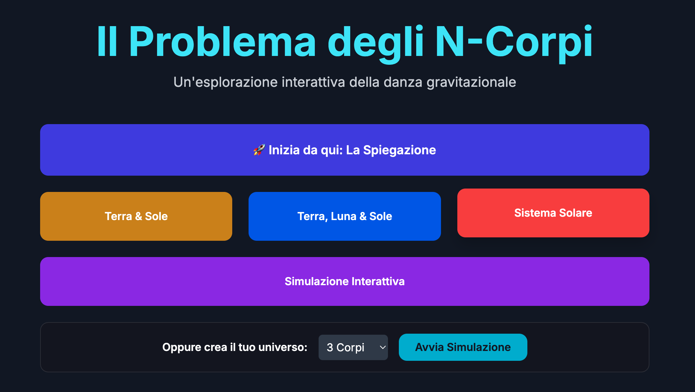
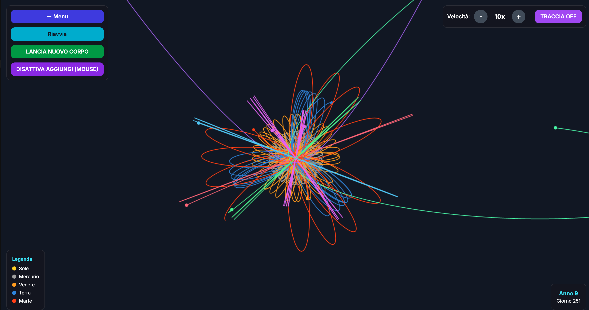

  

  
  
  
  

**Aggiungi un corpo e guarda cosa succede.** Un'applicazione web per simulare la danza gravitazionale tra corpi celesti, dal semplice sistema Terra-Sole a universi che costruisci tu, cliccando.

## In 30 secondi

| Scheda | Dettaglio |
|---|---|
| **Cos'è** | Un simulatore interattivo del problema degli N-corpi, con una sezione didattica |
| **Per chi** | Chi insegna o studia fisica e astronomia, e chi vuole *vedere* cosa significa caos |
| **Come provarlo** | [Apri la demo](https://robertomicarelli.github.io/3bodyproblem/) |

  
  

## Cosa puoi fare

| Modalità | Dettaglio |
|---|---|
| **Simulazioni predefinite** | Terra e Sole, Terra, Luna e Sole, Sistema Solare |
| **Simulazione personalizzata** | Scegli quanti corpi e osserva le interazioni casuali |
| **Simulazione interattiva** | Clicca sul canvas per aggiungere corpi: partono da fermi e interagiscono con il sistema |
| **Lancio di un nuovo corpo** | Parte da un punto casuale dello schermo, con massa e velocità calcolate per interagire con il corpo più piccolo: orbite o impatti |
| **Sezione didattica** | Problema dei due e dei tre corpi, teoria del caos, punti di Lagrange, video educativi |

## I controlli

| Comando | Cosa fa |
|---|---|
| **← Menu** | Torna al menu principale |
| **Riavvia** | Riparte da capo |
| **Velocità + / −** | Cambia la velocità della simulazione in tempo reale |
| **Traccia ON/OFF** | Attiva la traccia continua «a matita» delle traiettorie; da spenta le tracce hanno lunghezza limitata |
| **Lancia nuovo corpo** | Lancia un corpo nel sistema |
| **Aggiungi corpo (mouse)** | Attiva o disattiva l'aggiunta di corpi con il clic |

Una leggenda e una timeline mostrano i corpi presenti e il tempo simulato.

## Come si avvia

1. **In rete:** apri la [demo](https://robertomicarelli.github.io/3bodyproblem/).
2. **In locale:** scarica o clona il repository e apri `index.html` nel browser. Nessuna dipendenza, nessun server.

## Crediti

L'idea di aggiungere corpi con il mouse nasce dalla logica di `central_force.js` (Processing).

---

## English

An interactive, educational exploration of the gravitational dance between celestial bodies. It simulates N-body systems, from the simple Earth-Sun pair to custom and interactive configurations.

**Features:** predefined simulations (Earth and Sun; Earth, Moon and Sun; Solar System); custom simulations with a chosen number of bodies; click-to-add bodies that start at rest; launch a new body with computed mass and velocity; real-time speed control; continuous pencil-like trail on/off; legend and timeline; an educational section on the two- and three-body problem, chaos theory and Lagrange points.

**Run it:** open the [live demo](https://robertomicarelli.github.io/3bodyproblem/), or clone the repository and open `index.html`. No dependencies, no server.

---

**AI-utati** · By Roberto Micarelli · Formatore, Coach, Consulente · [ai-utati.it](https://www.ai-utati.it) · [Scheda sul sito](https://www.ai-utati.it/risorse/problema-n-corpi/) · [Tutti i progetti](https://github.com/RobertoMicarelli/brand-ai-utati)

**Provalo ora:** apri la demo, aggiungi un corpo vicino alla Terra e guarda cosa succede all'orbita.
